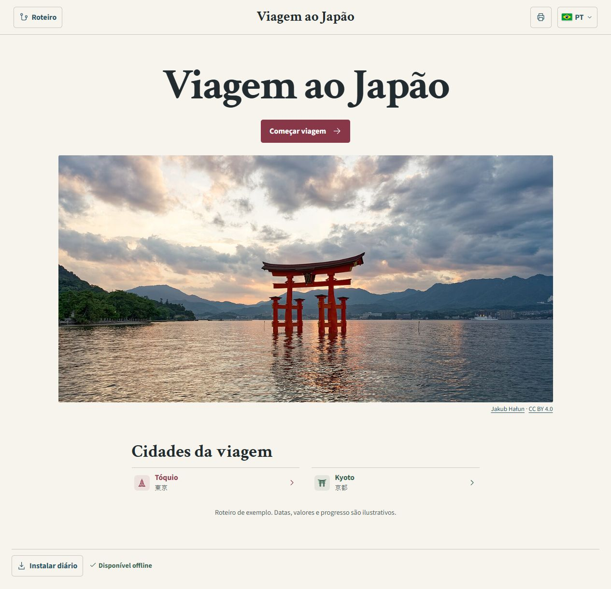
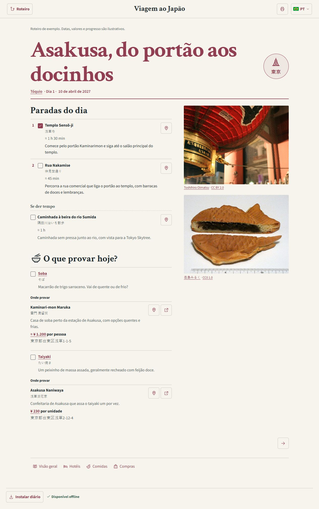
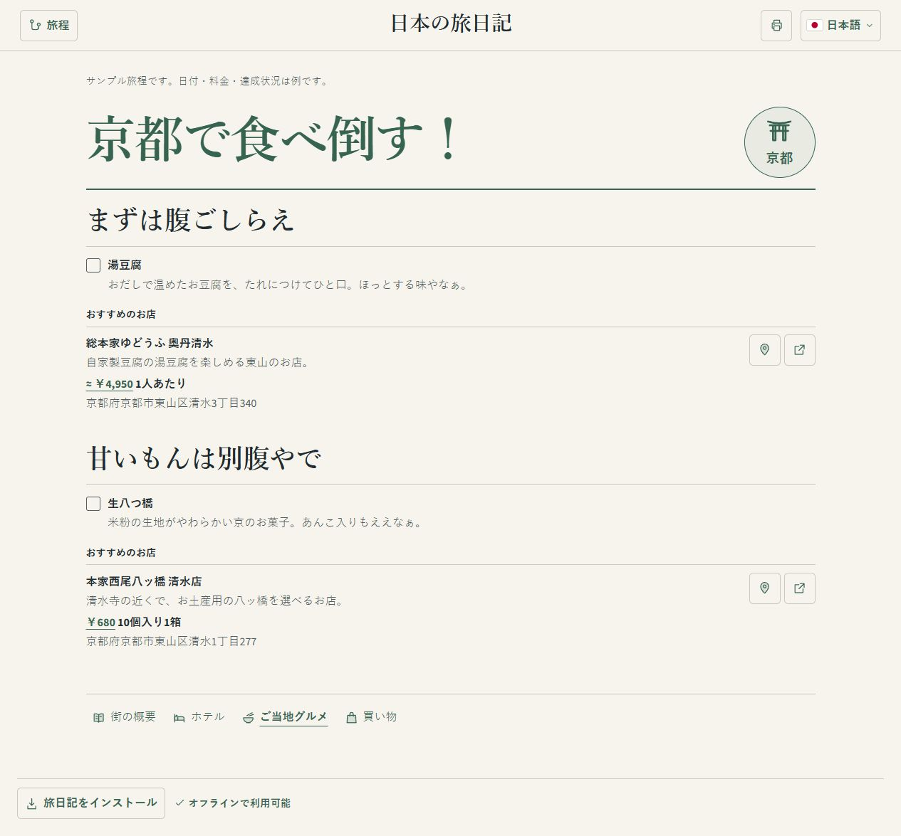

# JapanTrip · Viagem ao Japão

[](https://github.com/DuduRPP/JapanTrip/actions/workflows/pages.yml)
[](https://dudurpp.github.io/JapanTrip/)

Diário ilustrado para acompanhar uma viagem pelo Japão no celular ou no computador. A primeira versão inclui um roteiro demonstrativo de 12 dias entre Tóquio e Kyoto em português, japonês e inglês. [Abrir o diário](https://dudurpp.github.io/JapanTrip/)

[](https://dudurpp.github.io/JapanTrip/)

| Roteiro do dia em Asakusa | Comidas de Kyoto em japonês |
| --- | --- |
| [](https://dudurpp.github.io/JapanTrip/#/pt/dia/asakusa) | [](https://dudurpp.github.io/JapanTrip/#/ja/sabores/kyoto) |

## Como funciona

- **Roteiro** abre uma linha do tempo vertical em um painel lateral, com os dias agrupados por cidade, os deslocamentos e os atalhos para os guias. Quando a data do aparelho coincide com um dia do roteiro, o painel e a capa oferecem o atalho **Ir para hoje**.
- **Cada dia** traz paradas em ordem, duração aproximada, descrição, mapas e o trajeto até a próxima parada quando cadastrado. Também reúne passeios opcionais, comidas para provar e lojas próximas. Em telas largas as fotos ficam à direita do texto. No celular, a galeria vem primeiro.
- **Voltar ao topo** aparece no canto inferior direito depois que o cabeçalho sai da tela.
- **Cada cidade** tem cor e selo próprios e páginas de visão geral, hotéis, comidas e compras. Os deslocamentos trazem opções de transporte, duração e valor por pessoa.
- **Troca de idioma** conserva a página atual. Kyoto usa expressões de Kansai no japonês, como 「京都で食べ倒す！」 na página de comidas. O título da aba é **JapanTrip** em todas as páginas.
- **Instalação e modo offline** estão disponíveis pelo navegador. Abra o diário conectado e espere o indicador **Disponível offline**. O roteiro, as fotos locais e as fontes ficam no cache. Links externos, como mapas e operadoras, dependem de conexão.
- **Salvar em PDF** abre o roteiro completo no idioma atual. Use o botão de impressão nessa página e escolha salvar como PDF. A exportação usa os dados, os títulos, os selos e as cores da versão exibida.

## Stack

| Camada | Tecnologia |
| --- | --- |
| Interface | React 19, JavaScript com JSX, CSS responsivo e ícones SVG |
| Desenvolvimento e build | Vite 7, npm e Node.js 22 no GitHub Actions |
| Dados e idiomas | JSON versionado no Git, textos de interface em JavaScript e API `Intl` para datas, durações e ienes |
| Navegação | Rotas por fragmento de URL, como `#/ja/dia/fushimi`, servidas pelo mesmo `index.html` |
| PWA e PDF | Web App Manifest, service worker com cache versionado e impressão do navegador com CSS próprio |
| Hospedagem | GitHub Pages com publicação pelo GitHub Actions |

O build inclui os dados no JavaScript do site. A leitura é pública e a edição acontece no repositório, por quem tem acesso de escrita. Todas as pessoas veem as mesmas marcações da versão publicada.

## Rodar localmente

Use Node.js 22.12+ na linha 22, como no workflow de publicação.

```sh
npm ci
npm run dev
```

Abra o endereço exibido no terminal. Para conferir a versão de produção e o cache offline localmente, use `npm run build` e depois `npm run preview`.

## Preencher o roteiro

Edite [`src/data/trip.json`](src/data/trip.json) para montar a viagem. O arquivo começa com `demo: true`, que exibe o aviso de demonstração. Use `demo: false` quando o roteiro estiver pronto para ser apresentado como o da viagem.

Para transformar documentos e ideias de viagem em dados do site, use o [guia de pesquisa e preenchimento](docs/GUIA-PREENCHIMENTO.md). Ele inclui uma mensagem pronta para outro agente e orientações sobre fontes, traduções e identidade visual por cidade.

| Quero cadastrar | Onde preencher |
| --- | --- |
| Capa e cidades | `coverPhoto` aponta para uma foto. Em `cities`, cada cidade tem `id`, `name`, `description`, `photo`, `accent` e `symbol`. |
| Hotéis | Em `cities[].stays`, informe o nome, o preço inicial por noite em `fromYen` e o link em `url` quando houver. |
| Dias e paradas | Em `journey`, uma etapa `day` tem `id`, `city`, `number`, `date` no formato `AAAA-MM-DD`, `title` e `stops`. A duração de cada parada é `minutes`. Use `optional: true` para colocá-la em **Se der tempo**. |
| Trajetos entre paradas | Na parada de destino, use `travelFrom` com `stopId` da origem, `mode` e `minutes` estimados. `line` e `note` aceitam textos traduzidos. O trecho aparece no site e no PDF. |
| Deslocamentos | Insira uma etapa `transfer` na posição desejada de `journey`. `from` e `to` são IDs de cidade. Cada entrada em `options` tem nome, duração em `minutes`, preço por pessoa em `yen` e `url` opcional. |
| Pratos e restaurantes | Em `cities[].foods`, use `kind: "savory"` para salgado e `kind: "sweet"` para doce. `venues` lista os lugares onde provar, com `addressJa`, `url` e `price` quando disponíveis. |
| Compras | Cadastre cada loja em `cities[].shops` com `id`, nome, descrição, endereço em `addressJa` e link em `url` quando houver. |
| Sugestões do dia | Preencha `foodIds` e `shopIds` no dia com IDs de pratos e lojas cadastrados na mesma cidade. Escolha as lojas pela proximidade das paradas. |
| Fotos | Coloque o arquivo em `public/photos/` e registre o ID, caminho, texto alternativo, autoria, fonte e licença em [`src/data/photos.json`](src/data/photos.json). Use esse ID em `coverPhoto` ou `photo`. |

Nomes, títulos e descrições usam chaves `pt`, `ja` e `en`. Se faltar uma tradução, o site usa português. Para preços de restaurantes, `price` recebe `yen`, `unit` (`person`, `piece` ou `box`), `source` e, quando for estimativa, `estimated: true`.

Para marcar uma visita, altere `done` na parada. Para marcar o taiyaki como provado, altere `done` para `true` no prato `taiyaki` da cidade `tokyo`. A marcação aparece no guia de comidas, em todos os dias que sugerem o prato e na próxima exportação em PDF. Preserve os IDs usados em URLs e referências ao editar os textos.

## Branches e publicação

- [`main`](https://github.com/DuduRPP/JapanTrip/tree/main) é a branch de publicação. Cada push nela aciona o workflow **Publicar no GitHub Pages**.
- [`dev`](https://github.com/DuduRPP/JapanTrip/tree/dev) é a base para continuar o desenvolvimento. Integre as mudanças em `main` quando quiser publicá-las.
- [`example`](https://github.com/DuduRPP/JapanTrip/tree/example) guarda a primeira versão com os dados demonstrativos para consulta e reutilização.

Para configurar a hospedagem em outro repositório, em **Settings → Pages → Build and deployment → Source**, selecione **GitHub Actions**. Envie um commit para `main` ou rode o workflow manualmente nessa branch. O workflow instala as dependências, gera `dist/` e publica seu conteúdo.

Veja [CONTEXTO.md](CONTEXTO.md) para as decisões de produto, a estrutura dos componentes, os detalhes dos campos e o fluxo de atualização durante a viagem.
